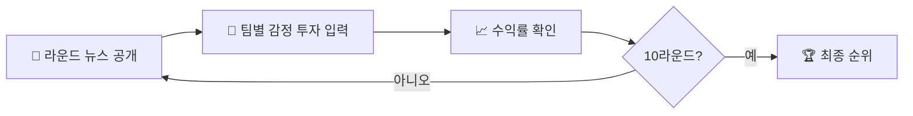

<div align="center">


**신내동 투자왕은 누구 !?**

6개 팀이 12가지 **감정**에 투자하고, 라운드마다 공개되는 **뉴스**를 단서 삼아 자산을 불려 가는 팀 대항 투자 게임입니다.


</div>

<br />

## 💰 게임 규칙

| 항목 | 내용 |
| :-- | :-- |
| 👥 참가 팀 | 6팀 |
| 💵 초기 자금 | 팀당 **1,000,000원** |
| 🪙 정보 코인 | 팀당 **7개** 지급 |
| 🔁 라운드 | 총 **10라운드** |
| 💭 투자 대상 | **12개의 감정** |
| 🏆 승리 조건 | 10라운드 종료 후 **최종 자산이 가장 높은 팀** |

### 💭 감정 투자 리스트

<div align="center">

| 😈 | 😇 |
| :--: | :--: |
| 탐욕 | 사랑 |
| 질투 | 믿음 |
| 분노 | 용기 |
| 나태 | 희망 |
| 슬픔 | 절제 |
| 두려움 | 화합 |

</div>

<br />

## 🎮 진행 방법



1. **시작 화면**에서 `🚀 게임 시작하기`를 누릅니다.
2. 라운드마다 화면 위에 **뉴스 한 줄**이 나옵니다. 어떤 이야기인지 추리해서 어떤 감정이 오를지 예측해 보세요.
3. 각 팀이 12개 감정 칸에 투자 금액을 입력합니다.
   - 숫자만 입력할 수 있고, 천 단위 콤마가 자동으로 붙습니다.
   - 투자 합계는 그 팀의 **보유 자산을 넘을 수 없습니다.**
4. `수익률 확인`을 누르면 감정별 증감률(🔴 상승 / 🔵 하락)과 팀별 수익이 공개되고, 보유 자산에 바로 반영됩니다.
5. `다음 라운드`로 넘어가면 투자 입력이 초기화됩니다.
6. 10라운드 정산이 끝나면 `최종 결과 보기`로 **🏆 최종 순위**를 확인합니다.

> 💡 **수익 계산**: 감정마다 `투자금 × 그 라운드의 수익률`을 돌려받습니다. 투자하지 않은 돈은 그대로 남습니다.
>
> 예) 사랑에 100,000원 투자, 수익률 +20% → 120,000원 회수 (**+20,000원**)

<br />

## 🚀 실행 방법

```bash
git clone https://github.com/yunssup/summer_coin.git
cd summer_coin
npm install
npm run dev
```

브라우저에서 `http://localhost:5173`을 열면 됩니다.

| 명령어 | 설명 |
| :-- | :-- |
| `npm run dev` | 개발 서버 실행 |
| `npm run build` | 배포용 빌드 (`dist/`) |
| `npm run preview` | 빌드 결과 미리보기 |
| `npm run lint` | ESLint 검사 |

<br />

## 📁 프로젝트 구조

```
summer_coin
├── index.html
├── src
│   ├── main.jsx               # BrowserRouter 설정
│   ├── App.jsx                # 라우팅 ( / , /Gamestart )
│   ├── GlobalStyle.jsx        # 전역 스타일 · 폰트
│   ├── assets/                # 마루부리, 경기천년바탕 폰트
│   └── page
│       ├── Start.jsx          # 시작 화면 (규칙 · 감정 리스트)
│       ├── Style.jsx
│       └── gamestart
│           ├── Gamestart.jsx  # 게임 진행 · 정산 · 최종 순위
│           └── Style.jsx
└── vite.config.js
```

<br />

## 🛠️ 진행자용 안내

라운드별 **뉴스**와 **감정 수익률**은 모두 [`src/page/gamestart/Gamestart.jsx`](src/page/gamestart/Gamestart.jsx)에 들어 있습니다.

| 바꾸고 싶은 것 | 수정할 곳 |
| :-- | :-- |
| 라운드 뉴스 문구 | `newsByRound` |
| 감정별 수익률 (`1.35` = +35%, `0.70` = -30%) | `emotionRatesByRound` |
| 감정 종류 | `emotions` (`Start.jsx`의 감정 리스트도 같이 수정) |
| 초기 자금 | `balances` 초깃값 |

> ⚠️ 이 레포는 공개되어 있어서, 참가자가 코드를 열어 보면 **정답(수익률)이 그대로 보입니다.** 게임 전에는 링크 공유에 주의하세요.

<br />

<div align="center">

Made with 💙 by [yunssup](https://github.com/yunssup)


</div>
